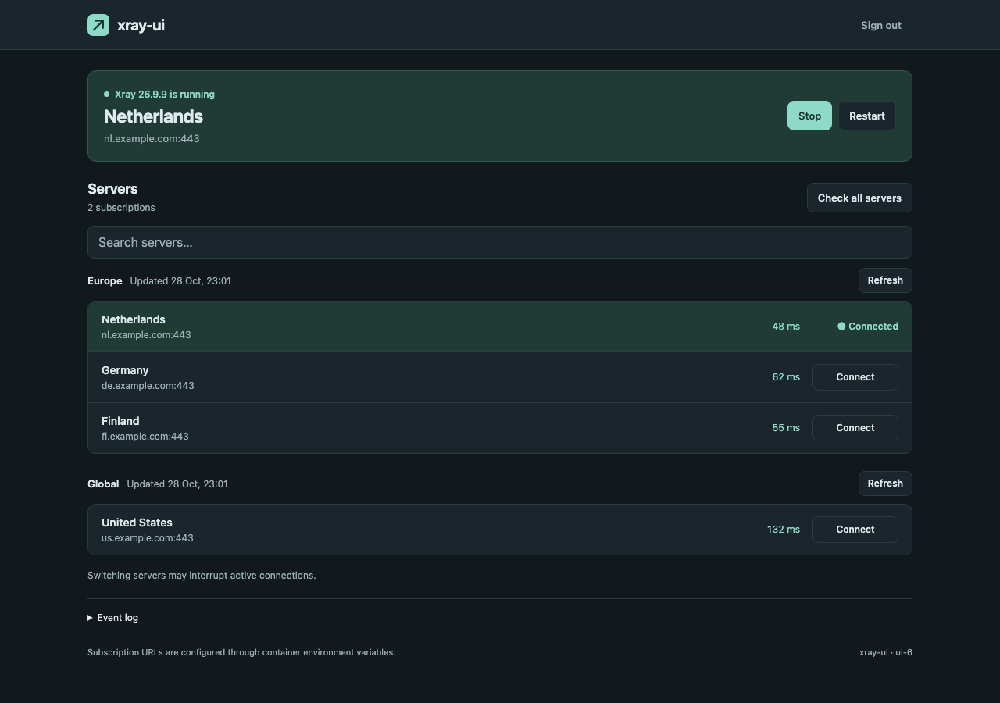

# xray-ui

Ready-to-run VLESS REALITY solution for MikroTik, powered by Xray with native TUN and a web panel.

A complete containerized VPN client: Xray handles traffic through native TUN, while the dark web panel manages subscriptions, server selection and latency checks. Subscription URLs are configured only through container environment variables.

Platforms: **Linux AMD64, ARM64 and ARMv7**. Alpine 3.24.3, Xray 26.9.9.



## Run on MikroTik

Requires RouterOS 7 with the container package enabled, a working container network and enough storage. The example assumes `xray-veth` is already configured as `172.18.20.6/30`, with gateway/DNS `172.18.20.5`, and VPN traffic is routed to it.

Add the environment variables:

```routeros
/container/envs/add list=xray-ui key=SUBSCRIPTION_URL value="https://provider.example/sub/YOUR_TOKEN"
/container/envs/add list=xray-ui key=PANEL_PASSWORD value="REPLACE_WITH_YOUR_PASSWORD"
```

Optional second subscription:

```routeros
/container/envs/add list=xray-ui key=SUBSCRIPTION_URL_2 value="https://another-provider.example/sub/YOUR_TOKEN"
```

Create the container. Set `PANEL_PASSWORD` to use your own password (4–32 characters), or omit it to generate one and print it to stdout on first start (the MikroTik container log):

```routeros
/container/config/set registry-url=https://registry-1.docker.io
/container/add name=xray-ui remote-image=gritsenko/xray-ui:latest interface=xray-veth envlists=xray-ui dns=172.18.20.5 root-dir=/docker/xray-ui logging=yes start-on-boot=yes
/container/start [find where name="xray-ui"]
```

Open **http://172.18.20.6:8080** and sign in with your configured password or the generated password from the container log.

Edit existing entries instead of duplicating them. These commands assume an existing container network; they do not configure MikroTik firewall, NAT or VPN traffic routing. Mount persistent storage at `/opt/xray/state` to retain the password and selected server when replacing the container.

## Environment variables

| Key | Value |
|---|---|
| `SUBSCRIPTION_URL` | `https://provider.example/sub/YOUR_TOKEN` |
| `SUBSCRIPTION_URL_2` | `https://another-provider.example/sub/YOUR_TOKEN` (optional; up to `_16`) |
| `PANEL_PASSWORD` | `REPLACE_WITH_YOUR_PASSWORD` |
| `SUBSCRIPTION_REFRESH_SECONDS` | `600` (10 minutes, default) |
| `PANEL_ADDRESS` | `0.0.0.0:8080` |
| `PROBE_URL` | `https://www.gstatic.com/generate_204` |

`PANEL_PASSWORD`: if set, uses that password; otherwise generates one and prints it to stdout on first start. Saved passwords are reused on restart. Passwords must contain 4–32 characters. Restart the container after changing environment variables.

`SUBSCRIPTION_REFRESH_SECONDS=0` disables scheduled refresh.

Supports plain-text and Base64 `vless://` subscriptions: **IPv4, TCP/RAW + REALITY**, with optional `xtls-rprx-vision`. Other protocols/transports are skipped. Source names come from `profile-title`, falling back to the subscription hostname.

Startup connects to the saved server if reachable, otherwise the first working server as subscriptions are loaded. Later slow sources do not delay an available connection. Explicit Stop remains stopped across restarts. Failed updates retain the previous configuration. Switching servers can interrupt connections. Latency is an HTTPS request through the VPN, not a bandwidth test.

## Build your own image

Requires Docker with Buildx. Xray is downloaded from its official release and checked against `build/xray-checksums.txt`; no binary archives are stored in this repository.

Build one platform locally (replace `linux/arm64` as needed):

```sh
docker buildx build --platform linux/arm64 --target final \
  --provenance=false --sbom=false \
  -t your_username/xray-ui:test --load .
```

Publish all three platforms under one tag. Replace the image name with your Docker Hub repository, then use that same name in `remote-image` on MikroTik:

```sh
docker login
docker buildx build --platform linux/amd64,linux/arm64,linux/arm/v7 \
  --target final --provenance=false --sbom=false \
  -t your_username/xray-ui:test --push .
```

ARMv5 devices such as hEX Refresh are not supported by this Alpine image.

## Tests

```sh
go test -race ./...
go vet ./...
node --test tests/panel-ui.test.cjs
```

Optional network integration test inside a disposable privileged container:

```sh
docker buildx build --platform linux/arm64 --target test -t xray-ui-test --load .
docker run --rm --privileged --platform linux/arm64 xray-ui-test
```

The final runtime image contains no Go compiler, Python, curl, jq or web-server dependency. See [third-party notices](THIRD_PARTY.md).
