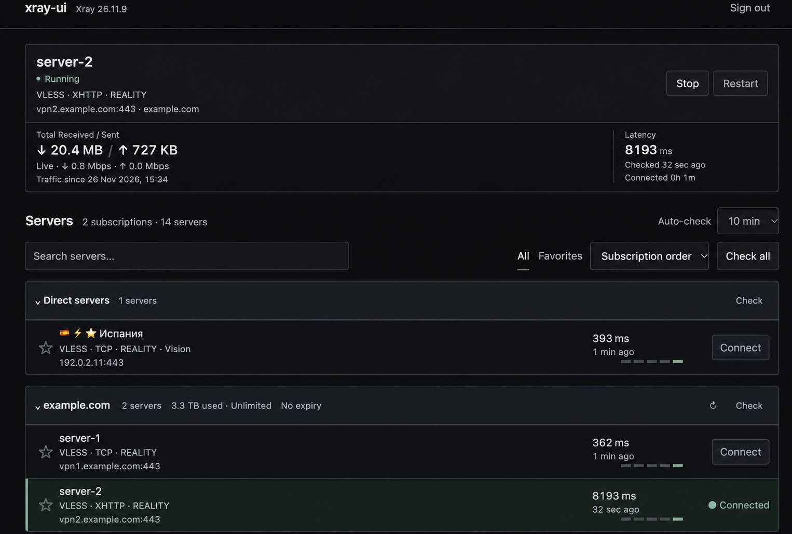

# xray-ui
 
Ready-to-run VLESS and Hysteria2 client for MikroTik, powered by Xray with native TUN and a web panel. [Docker Hub](https://hub.docker.com/r/gritsenko/xray-mikrotik-ui/tags?name=latest)

### [How to Route Traffic Through the Tunnel(RU)](https://gist.github.com/degritsenko/64bd43e0d854fc730b71a45872be3542)

A complete containerized VPN client: Xray handles traffic through native TUN, while the dark web panel manages subscriptions, server selection and latency checks. Subscription URLs and direct server links are configured through container environment variables.

Platforms: **Linux AMD64, ARM64, ARMv7 and ARMv5**. Xray 26.11.9.


The dark panel includes favorites, latency sorting, automatic HTTPS checks and the last five check results per server. Subscription traffic, quota and expiry are shown when reported by the provider. Failed checks retain the last successful latency; subscription errors stay beside the affected source.



## Run on MikroTik

Create the container interface and assign the gateway address directly to it:

```routeros
/interface/veth/add name=xray-veth address=172.18.20.6/30 gateway=172.18.20.5
/ip/address/add address=172.18.20.5/30 interface=xray-veth
```

Add the environment variables:

```routeros
/container/envs/add list=xray-ui key=SUBSCRIPTION_URL value="https://provider.example/sub/YOUR_TOKEN"
/container/envs/add list=xray-ui key=PANEL_PASSWORD value="REPLACE_WITH_YOUR_PASSWORD"
```

Optional second subscription or direct server:

```routeros
/container/envs/add list=xray-ui key=SUBSCRIPTION_URL_2 value="https://another-provider.example/sub/YOUR_TOKEN"
/container/envs/add list=xray-ui key=SRV1 value="vless://YOUR_SERVER_LINK"
```

Create the container. Set `PANEL_PASSWORD` to use your own password (4–32 characters), or omit it to generate one and print it to stdout at startup (the MikroTik container log):

```routeros
/container/config/set registry-url=https://registry-1.docker.io
/container/add name=xray-ui remote-image=gritsenko/xray-mikrotik-ui:latest interface=xray-veth envlists=xray-ui dns=172.18.20.5 root-dir=/docker/xray-ui logging=yes start-on-boot=yes
/container/start [find where name="xray-ui"]
```

Open **http://172.18.20.6:8080** and sign in with your configured password or the generated password from the container log.

Edit existing entries instead of duplicating them. Configure firewall, NAT, gateway DNS and VPN traffic routing for your network.

## Environment variables

| Key | Value |
|---|---|
| `SUBSCRIPTION_URL` | `https://provider.example/sub/YOUR_TOKEN` |
| `SUBSCRIPTION_URL_2` | `https://another-provider.example/sub/YOUR_TOKEN` (optional; up to `_16`) |
| `SRV1`, `SRV2` … `SRV16` | Direct `vless://`, `hysteria2://` or `hy2://` links (optional) |
| `PANEL_PASSWORD` | `REPLACE_WITH_YOUR_PASSWORD` |
| `SUBSCRIPTION_REFRESH_SECONDS` | `600` (10 minutes, default) |
| `PANEL_ADDRESS` | `0.0.0.0:8080` |
| `PROBE_URL` | `https://www.gstatic.com/generate_204` |
| `XRAY_LOG_LEVEL` | `warning` (main Xray: `debug`, `info`, `warning`, `error`, `none`) |
| `PROBE_LOG_LEVEL` | `none` (server checks: same levels; set `debug` for diagnostics in container logs) |

`PANEL_PASSWORD`: if set, uses that password; otherwise generates one and prints it to stdout at startup. Passwords must contain 4–32 characters. Restart the container after changing environment variables.

`SUBSCRIPTION_REFRESH_SECONDS=0` disables scheduled refresh.

Subscriptions accept plain-text or Base64 lists of supported VLESS and Hysteria2 links. VLESS supports TCP/RAW + REALITY (including Vision), XHTTP + REALITY/TLS/none and gRPC + REALITY/TLS. Source names come from `profile-title`, falling back to the subscription hostname.

Direct links in `SRV1`–`SRV16` appear under **Direct servers**, before subscriptions. Standard `vless://`, `hysteria2://` and `hy2://` links are supported, as are Base64 VLESS links for gRPC + TLS or TCP + REALITY + Vision. Direct links are read at startup; change the environment variable and restart the container to update one.

Hysteria2 supports `sni` or `peer` for TLS and optional Salamander obfuscation. It requires outbound UDP and a valid TLS certificate. Insecure TLS, port hopping and certificate pins such as `hpkp` are not supported.

### Server checks

The panel checks servers sequentially using a temporary Xray process. It makes an HTTPS request through each VPN server to `PROBE_URL` (default: `https://www.gstatic.com/generate_204`), then stops the temporary process. The active connection stays running. A failed check is retried once; its last successful result and the five latest check outcomes are shown in the panel. Latency measures the request through the VPN, not bandwidth.

Automatic checks run every 10 minutes by default, with the active server checked approximately every minute. Select Off, 5, 10 or 30 minutes in the panel. Check all servers, one group or an individual server manually; a manual check interrupts a background check. Results and the interval reset when the container restarts.

The panel shows current tunnel speed, traffic since container startup, connection time, favorites and sorting by latency. Subscription traffic, quota and expiry are shown when provided by the subscription. Favorites and display preferences are stored in the browser.

At startup, the manager loads sources from the environment and connects to the first working server. Failed subscription updates retain the previous configuration. Switching servers can interrupt existing connections.

## Build your own image

Requires Docker with Buildx. Xray is downloaded from its official release and checked against `build/xray-checksums.txt`; no binary archives are stored in this repository.

Build one platform locally (replace `linux/arm64` as needed):

```sh
docker buildx build --platform linux/arm64 --target final \
  --provenance=false --sbom=false \
  -t your_username/xray-ui:test --load .
```

Publish all four platforms under one tag. Replace the image name with your Docker Hub repository, then use that same name in `remote-image` on MikroTik:

```sh
docker login
docker buildx build --platform linux/amd64,linux/arm64,linux/arm/v7,linux/arm/v5 \
  --target final --provenance=false --sbom=false \
  -t your_username/xray-ui:test --push .
```


## Tests

```sh
go test -race ./...
go vet ./...
node --test tests/panel-ui.test.cjs
```

Optional network integration test inside a disposable privileged container:

```sh
docker buildx build --platform linux/arm64 --target test -t xray-ui-test --load .
docker run --rm --privileged --platform linux/arm64 xray-ui-test
```

See [third-party notices](THIRD_PARTY.md).
